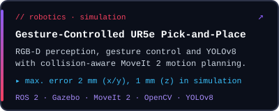
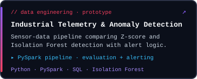
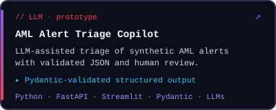
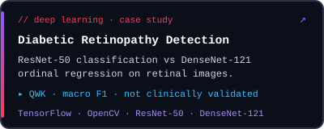
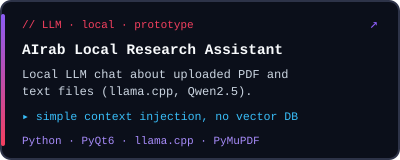
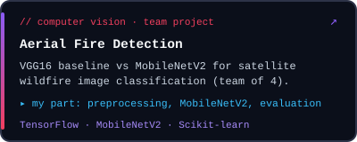
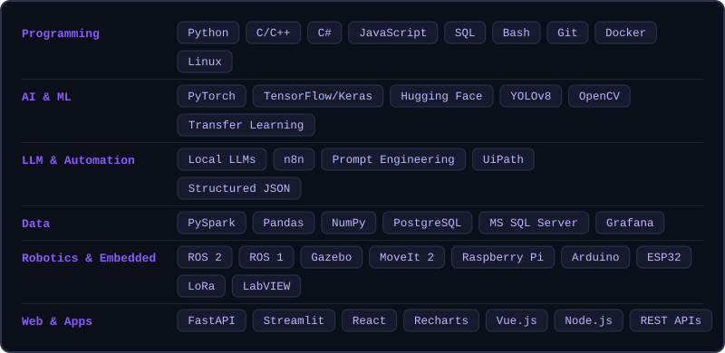

  

<!-- Animated glitch banner: upload the GIF to assets/profile-glitch.gif -->

  

  
  
  
  
  

M.Eng. student in **AI for Smart Sensors and Actuators** (Deggendorf Institute of Technology) with a **B.Eng. in Mechatronics**. I connect AI and software with real sensor data, robotics and automation, and I like turning technical ideas into systems that are practical, understandable and testable.

| | |
|---|---|
| **Now** | M.Eng. coursework completed, Master's thesis next |
| **Looking for** | AI, robotics, computer vision, data engineering, embedded systems, engineering management or automation position |
| **Location** | Germany, **open to relocation** |
| **Languages** | English (C2) · German (B2–C1) |
| **Strengths** | Computer vision · ROS 2 simulation · anomaly detection · local LLM prototypes · sensor and embedded systems · team leadership |

<table>
  <tr>
    <td width="50%" align="center"></td>
    <td width="50%" align="center"></td>
  </tr>
  <tr>
    <td width="50%" align="center"></td>
    <td width="50%" align="center"></td>
  </tr>
  <tr>
    <td width="50%" align="center"></td>
    <td width="50%" align="center"></td>
  </tr>
</table>

 More: <a href="https://github.com/ali76-AFK/UR5-Manipulator-with-Ubuntu-16.04-ROS1-kinetic-and-color-Recognition">UR5 manipulation with ROS 1</a>  <a href="https://github.com/ali76-AFK?tab=repositories">all repositories</a>

| Role | Where | When | Highlights |
|---|---|---|---|
| **Working Student**, UiPath & C# Automation | Deggendorf Institute of Technology | 06/2025 – 11/2025 | Built a UiPath course with practical use cases; web-scraping automation for data pipelines |
| **Project Collaboration**, ML & Computer Vision | ICON, Malaysia | 03/2024 – 07/2024 | YOLO-based camera violation detection; OCR and object-detection use case; data prep and annotation |
| **German Lecturer** | 4C | 10/2023 – 07/2024 | Taught German at A1–B1 levels |
| **Engineering Intern**, Mechatronics | SURECO, Malaysia | 07/2022 – 09/2022 | Student-team leader in an industry engineering study on a vortex-generator concept |
| **Student Research Assistant**, ML & Sensor Data | IIUM / Malaysian Nuclear Agency | 11/2019 – 02/2023 | Pulsed-eddy-current measurements, LabVIEW data acquisition, probe design |

**Machine-Learning-Based Evaluation of Corrosion Under Insulation in Ferromagnetic Structures**, *IIUM Engineering Journal, 2021* · co-author ([DOI](https://doi.org/10.31436/iiumej.v22i2.1692)).
My part: experimental Pulsed Eddy Current measurements, LabVIEW data acquisition, probe development and data preparation.

- **M.Eng. Artificial Intelligence for Smart Sensors and Actuators**, Deggendorf Institute of Technology, 03/2025 – present. Focus: machine learning, deep learning, computer vision, sensor systems, intelligent automation.
- **B.Eng. Mechatronics**, International Islamic University Malaysia, 02/2019 – 02/2023. Graduated with distinction (German-equivalent grade 2.0). Research in pulsed eddy current, signal processing and sensor development.

- **Co-founder, Arobot**: voluntary student initiative with workshops and Arduino/Raspberry Pi projects for about 150 participants.
- **Team leader**: IoT hydroponic system and Jetson Nano attendance-recognition app.
- **Robocon university team**: electronics, coding and testing for an arrow-shooting robot.
- **2nd place** at EDUTECH 2021 and at the IIUM CNN traffic-control competition 2022; Dean's List twice.

  Interested in a thesis topic, working-student role or internship? Write to me, I reply quickly.  
  
  
  

<i>Building intelligent systems. Connecting software, sensors and the physical world.</i>

